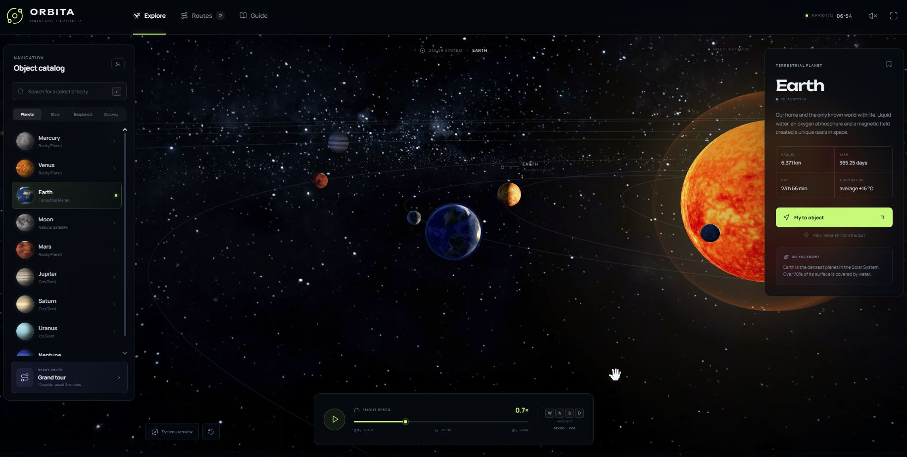

# Orbita — a journey through the universe

An interactive 3D space exploration simulator in the browser: a Solar System with real orbital periods, stars, exoplanets and galaxies built from tens of thousands of particles.

  



## Features

- **31 objects** in four categories: planets and the Moon, stars (Sirius, Betelgeuse, TRAPPIST-1 and more), exoplanets (Proxima b, Kepler-452 b…), galaxies (Milky Way, Andromeda, Sombrero, Cigar…)
- **Two scale levels** — stellar and galactic, with automatic switching: fly into the Milky Way to find yourself among the stars; travel far enough away and only galaxies remain
- **Real orbital ratios**: an Earth year ≈ 120 seconds at 1× speed, axial tilts and orbital inclinations from reference data
- **Particle galaxies**: up to 68,000 stars per object with bulge, bar and spiral arms
- **Procedural textures**: exoplanet and star surfaces generated on canvas on the fly
- **Grand tour** — a ready-made route of 10 worlds: Solar System → Sirius → Proxima b → Andromeda → back to the Sun
- **Routes** — save objects to your journal (localStorage)
- **Free flight** — WASD/QE + mouse, autopilot, adjustable speed 0.1×–100×
- **Dynamic sound** — a looped track whose volume rises near any object (150%) and fades with distance (30%)

## Getting started

```bash
npm install
npm run dev      # http://localhost:5173
npm run build    # production build to dist/
npm run preview  # preview the build
```

## Controls

| Action | Input |
|---|---|
| Look around | LMB + mouse move |
| Zoom | Mouse wheel |
| Fly | `W` `A` `S` `D`, `Q`/`E` — down/up, `Shift` — boost |
| Autopilot | `Space` or the play button |
| Search | `/` |
| Set course | Click a planet/star/galaxy or the "Fly to object" button |

## Structure

```
├── index.html          # entry point
├── public/textures/    # NASA / JPL, Solar System Scope textures + noise.mp3
└── src/
    ├── main.js         # UI: catalog, details, routes, tour, sound
    ├── scene.js        # UniverseScene: Three.js scene, scale levels, travel
    ├── data.js         # object catalog + Grand Tour route
    └── style.css       # interface styles
```

## Technologies

- [Three.js](https://threejs.org) — scene rendering (WebGL, custom shaders for particles and atmospheres)
- [Vite](https://vite.dev) — bundler and dev server
- [Lucide](https://lucide.dev) — icons
- Web Audio API — background sound with dynamic volume driven by object proximity

## A note on scale

Orbital distances and period ratios in the Solar System are true to life, but time is accelerated. Body sizes are enlarged for clarity. Stars and exoplanet surfaces are artistic procedural reconstructions. Planet textures: NASA / JPL, Solar System Scope.
